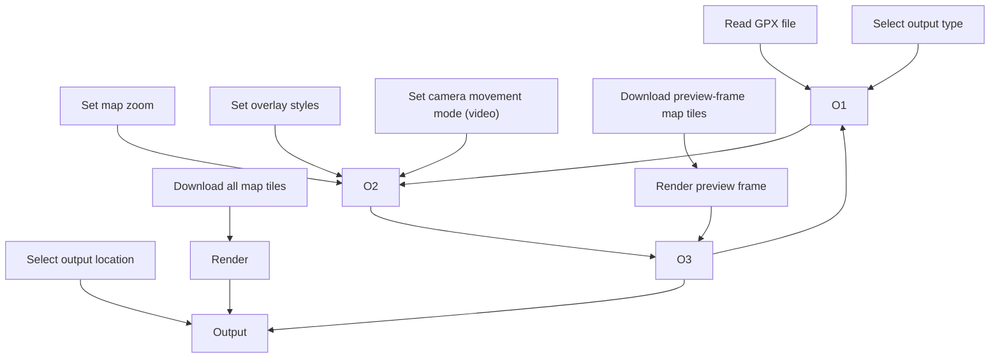

# **GPX Video Maker**


> 📍 **From GPX track to polished video, in one step.**


Please leave a free Star⭐ if you find this useful. Thank you!

This is a Python project managed with [uv](https://github.com/astral-sh/uv).

It renders GPX tracks into track animation videos.

## ✨ Features

* 📍 GPX track parsing
* 🎬 High-definition FFmpeg rendering
* 🗺️ AMap (Gaode) map tile support
* 🖱️ GUI file-picker interface

## 📋 Prerequisites

This project depends on FFmpeg. Please install it and configure the environment variable yourself.

## 🛠 Quick Start

If you already have `uv` installed, it only takes two steps to run:

1️⃣ **Clone the repository and enter the directory**:
```bash
git clone https://github.com/zhangshaojia07/GPXVideoMaker.git
cd GPXVideoMaker
```

2️⃣ **Sync the environment and run**:
```bash
uv sync
uv run main.py
```

*(These commands automatically create a virtual environment, install dependencies, and run the script.)*

## 🐍 Traditional approach (using pip)

If you do not have `uv` installed, you can use the traditional `pip` workflow instead:

Click the green **Code** button 👉 **Download ZIP** 👉 extract it to a folder you like.

1️⃣ **Create a virtual environment**:
```bash
python -m venv .venv
source .venv/bin/activate  # Windows: .venv\Scripts\activate
```

2️⃣ **Install dependencies**:
```bash
pip install -r requirements.txt
```

3️⃣ **Run**:
```bash
python main.py
```

## 💡 Tips

If the file-picker window does not pop up, run `export GUI=False` (Linux/Mac) or `set GUI=False` (Windows) in the terminal.

> If you do not want to type the command every time, you can hardcode `enable_GUI` in `utils.py`.

The source GPX file of the demo animation is available under the `debug/` directory for testing.

Map tiles come from AMap (Gaode). If you switch tile providers, remember to adjust the coordinate system accordingly.

## 🤝 Contributing & Feedback

Issues and Pull Requests are welcome.

## ✅ TODO
- [x] Let the user choose how to render long stretches without track points
- [x] Let the user choose the camera center longitude/latitude algorithm
  - [x] Add camera cage mode for the follow mode
  - [x] Add the switch mode
    - [ ] EaseInOut camera movement when switching (freeze time or not)
- [x] Preview rendering
  - [ ] Configure preview parameters
- [x] Update the usage tutorial in the README
- [ ] Add an "I only need a single overall image" mode

## 🚦 Project Flow



## 📜 Copyright & License

[](LICENSE)
[](NOTICE)

The project code is open-sourced under the **[MIT License](LICENSE)**.
For third-party font and game asset copyright details, see the **[NOTICE file](NOTICE)**.
